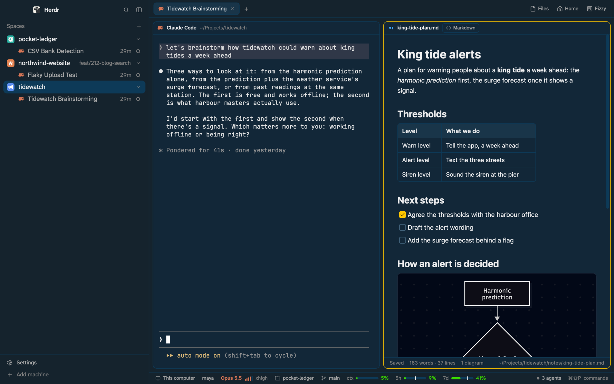
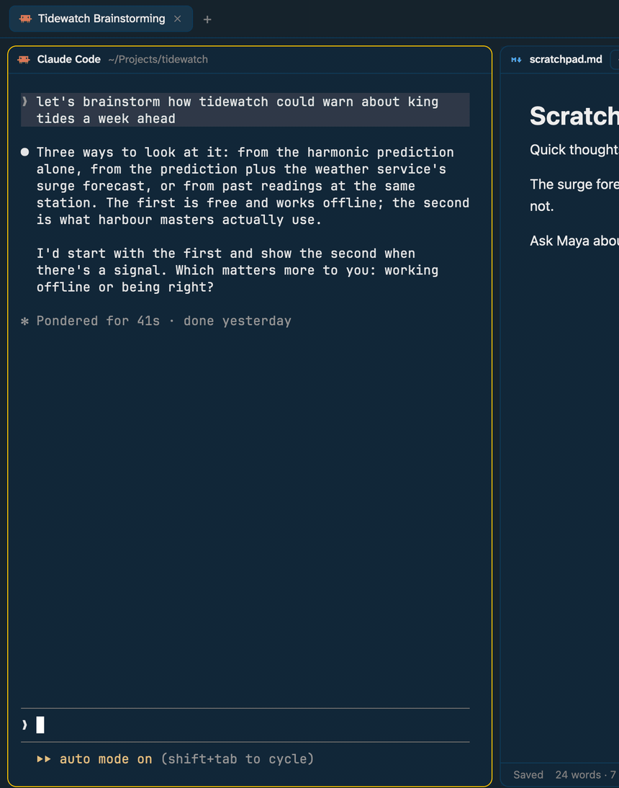
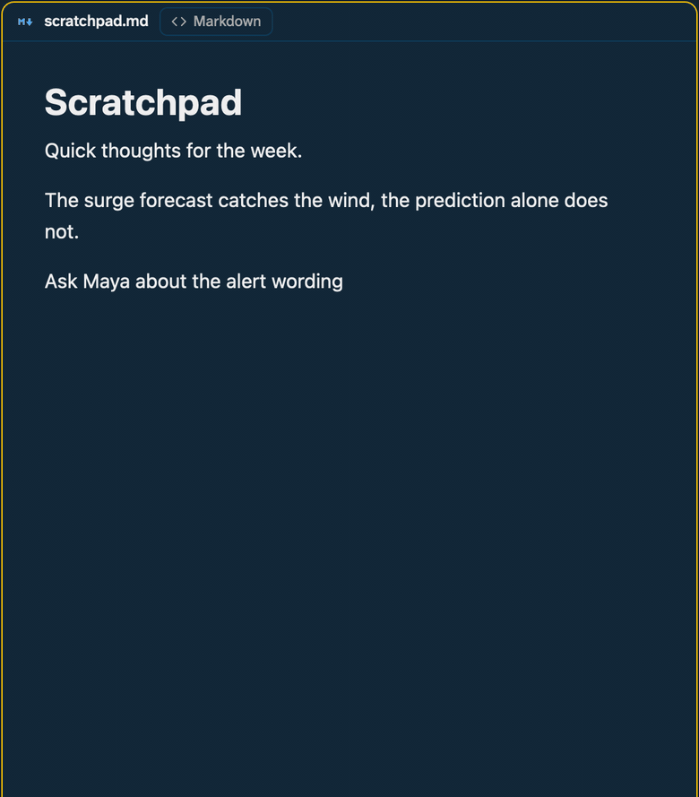
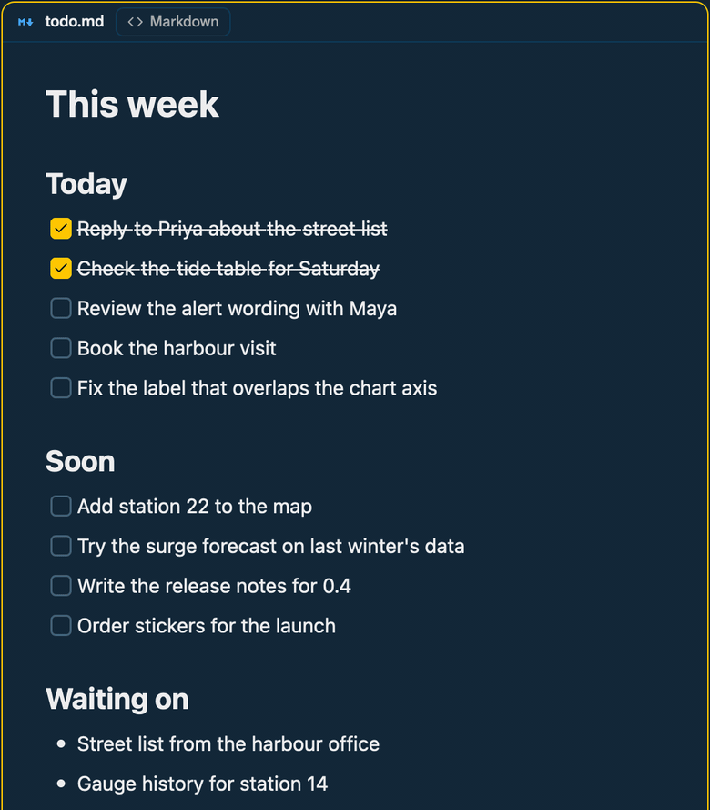
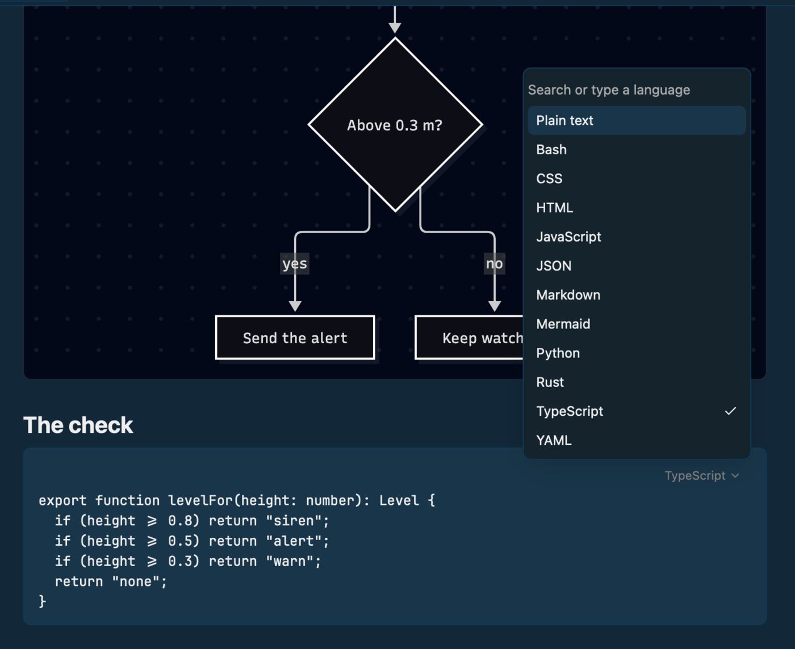
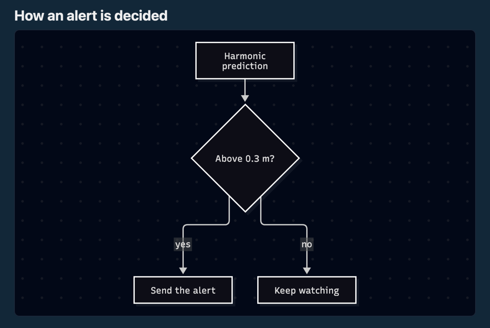
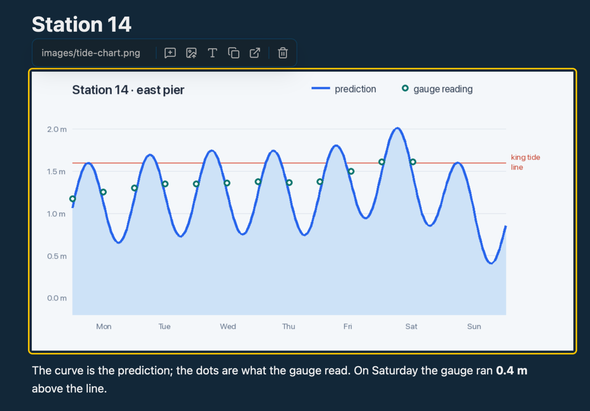
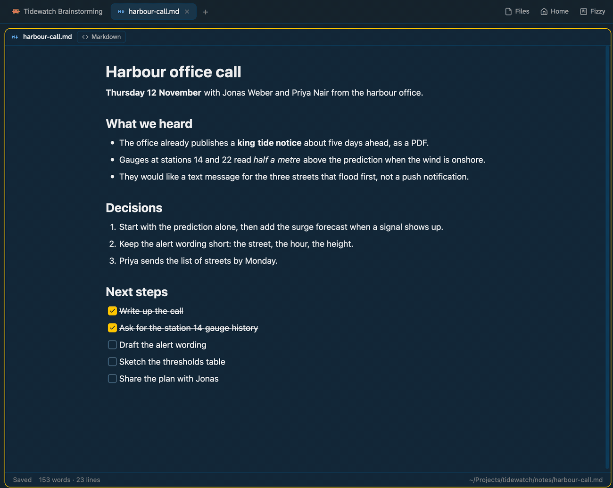
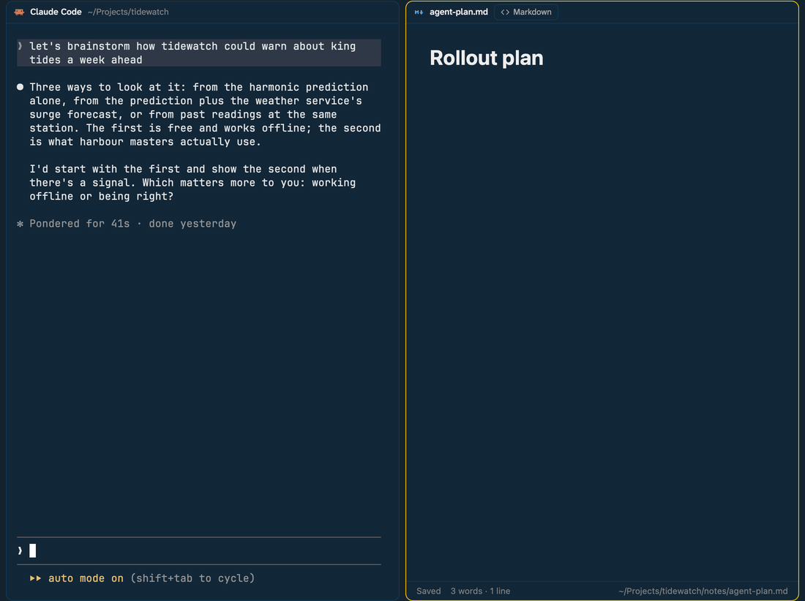

# Potion

Potion is a Herdr mod: a Markdown reader and editor that works as a notepad beside your terminals and shows the plans
agents write as they write them. A **Markdown pane** shows one markdown file as a rendered page you edit in place, or
as its source, and saves what you type. It opens beside your terminals in the current tab, or in a tab of its own.



_The notes, folders and chats in the screenshots and GIFs are made up._

This page is the short version. [docs/REFERENCE.md](docs/REFERENCE.md) has every detail.

## Features

### Pick a note

Cmd+M opens the file picker. It lists the markdown files of the folder of the focused pane, else of the space's: type
to filter, Up and Down to move, Enter to open, and recent files come first. A file opens in a new tab; Cmd+Shift+M
opens the same picker and puts the chosen file beside the focused pane.


### Make a note and write in it

Type a name no file has into the picker and it offers to create that file (`.md` is added when the name has no
markdown extension, and folders in the name are made); **New note** makes `untitled.md`. The new file opens with an
empty line to type in, and the page is the editor: click any paragraph, heading, list item, table or code block and
type. Typed markdown works as a shortcut: `# ` makes a heading, `- ` a bullet, `[] ` a task, and `**bold**` turns bold
as you close it. No markdown mark ever shows on the page; the marks stay in the file.



### Format the text

Select text and a bar opens over it: Comment, Text style, Bold, Italic, Underline, Strikethrough, Code, Colour, List
and Link. Colour sets a text colour (red, yellow, green, teal or purple) or a yellow highlight, and Text style turns
the block into a heading or a quote. The keys do the same, and the file stays plain markdown.


### Slash menu

Type `/` at the start of a block or after a space for a menu of block types: Text, Heading 1-3, Bulleted, Numbered and
To-do list, Quote, Code block, Mermaid diagram, Image, Table and Divider. Typing on narrows it (`/h2`, `/todo`, `/img`,
`/mer`); Enter, Tab or a click picks it, and Escape closes it.



### Tick tasks

A task list is drawn as boxes: click one to tick or untick it, or press Cmd+Enter on the task you are editing. `[] ` at
the start of a paragraph, or To-do list in the slash menu or the format bar, starts a list.



### Tables

A table is drawn as an editable grid of cells, with no pipes: click a cell and type. Tab and Shift+Tab select the text of
the next and the previous cell, and Tab in the last cell adds an empty row. Drag the line between two columns to set a column's
width; it is saved as the dashes of the delimiter row, so the file stays a plain table.


### Code blocks

Every code block shows its language on a chip at the top right (Plain text when it has none). Click the chip for the
language menu: type to narrow it by name or a usual alias (`py`, `sh`, `ts`), and Enter picks one. The language is
written where markdown keeps it, after the opening fence. In code, typing stays as typed, with no formatting or slash
menu, and code has no syntax colours.



### Diagrams

Fenced blocks tagged `mermaid` are drawn as pictures, in the colours of the current Herdr theme: pick **Mermaid
diagram** in the slash menu, type the diagram, and it is drawn when the cursor leaves the block. Double-click a diagram
to edit its source, drag it to move it, and Cmd+scroll to zoom. `install.sh` sets up the renderer (mermaid-cli driving
a headless Chrome); without it a diagram shows as a code block.




### Pictures

A paragraph made only of images, ``, is drawn as pictures. Add one with **Image** in the slash menu (the
macOS file dialog) or by dropping image files from Finder; a picture from outside the note's folder is copied into an
`images/` folder beside the note. Click a picture to pick it: a ring goes around it and a menu shows over it, with
Comment, Change picture, Alt text, Copy address, Open picture and Delete picture.



### Comments in the margin

Select text and press Cmd+Alt+M, or choose Comment on the format bar: a card opens beside the text and Enter saves it.
Comments are written into the file as [CriticMarkup](https://criticmarkup.com), with the time, so an agent reading the
file sees each one next to the text it is about:

```
The release {==ships on Friday==}{>>2026-11-16 20:51 | too early? QA needs a day<<} and the docs follow on Monday.
```

In a pane at least 836 px wide the cards sit in the margin, level with their text; in a narrower pane a small box opens
over the selection. **Resolve** takes a comment and its marks off; the marked text stays.



### Reading and Markdown views

A file opens as a rendered page, called Reading. The **Markdown** button at the right of the toolbar, or Cmd+E from
anywhere in the pane, shows the whole file as source in the terminal font, and back. Your place and your caret are kept
both ways, and each file opens in the state it was last in.


### Watch a plan being written

When the file changes on disk and you have nothing unsaved, the page updates, so a plan an agent writes into a file
renders as it goes. With unsaved edits, a change elsewhere in the file is merged into yours and saved; only a change
to the lines you edited raises a banner, "Changed on disk", with **Keep mine** and **Load theirs**.



### And more

- **Panes and tabs.** By default a file opens as a new pane to the right of the focused pane; a file already shown in
  a pane of that tab gets the focus instead of a second pane. A file that already has a Markdown tab goes to that tab.
- **Links.** Cmd+click opens a link; a plain click selects it and shows a popover with Open, Copy, Edit and Remove.
- **Saving.** 700 ms after you stop typing, on a tick, on a switch between Reading and Markdown, on Cmd+S and when
  the pane or tab closes. The footer says Saving…, Unsaved or Saved, with the words and lines, the number of comments,
  the diagram status and the path.
- **Copy and paste.** Cmd+C copies the selection as markdown that keeps its formatting; pasted markdown, a chat
  answer say, arrives as blocks: its headings, lists and code.
- **Limits.** A file on another machine is read-only for now, and a file over 1 MiB shows a message instead of its
  text.

## Install

You need:

- Herdr 0.1.16. The mod reads the selection of its text fields, which Herdr 0.1.16 added.
- Node.js, which `install.sh` uses to merge the keys into your `keys.json`. The diagram renderer needs Node.js 22.12
  or newer; without it the mod works and a diagram shows as a code block.
- For diagrams, about 440 MB of `node_modules` and about 200 MB for the `chrome-headless-shell` build that puppeteer
  downloads, and a few minutes the first time.
- `git` on the machine of the folder you open files from: the picker lists markdown files with `git ls-files`, or
  with `find` outside a repository.
- `curl` for pictures from the web, and `osascript` for the picture dialog (macOS ships both).

```sh
./install.sh                 # the two mods, their keys, then the diagram renderer
./install.sh --no-mermaid    # no diagram renderer
./install.sh --no-keys       # leave your keys.json alone
./install.sh --replace-keys  # also take over cmd-m / cmd-shift-m when you bound them to something else
```

The script copies `mods/potion` and `mods/potion-beside` into `${HERDR_APP_HOME:-~/.config/herdr-app}/mods/`, merges
`keys.json` into the `keys.json` there, and installs the diagram renderer in `~/.local/share/potion/mermaid`. It can be
run again at any time. Herdr reloads mods and `keys.json` as their files change, so there is nothing to restart.

[docs/REFERENCE.md](docs/REFERENCE.md#install) has what a re-run does, how the keys are merged and what each
requirement is for.

## Keys

`install.sh` binds two keys:

| Keys | What it does |
|---|---|
| `cmd-m` | Opens the file picker; the chosen file opens in a new tab |
| `cmd-shift-m` | Opens the same picker; the chosen file opens beside the focused pane |

`cmd-m` is also the macOS shortcut for minimizing a window: Herdr's key wins while it is bound. Bind other keys to the
two actions in `keys.json` if you want it back, and run `install.sh --no-keys` from then on.

In a Markdown pane:

| Keys | What it does |
|---|---|
| Cmd+E | Switches between the rendered page and the Markdown source |
| Cmd+S | Saves now |
| Cmd+B, Cmd+I, Cmd+U, Cmd+Shift+X | Bold, italic, underline and strikethrough on the selection |
| Cmd+Shift+C, Cmd+Shift+H | Inline code and a highlight on the selection |
| Cmd+K | Links the selection |
| Cmd+Alt+M | Comments on the selection |
| Cmd+Enter | Ticks the task being edited |
| Option+Up, Option+Down | Moves the block above or below its neighbour |
| Cmd+Z, Cmd+Shift+Z | Undo and redo, in the page and the source, and across switching between them |

[docs/REFERENCE.md](docs/REFERENCE.md#keys) has how the two keys work, and
[docs/REFERENCE.md](docs/REFERENCE.md#block-editing) every key and click in the editor.

## Integrations

[`integrations/`](integrations/README.md) has one folder per optional integration, each with a patch and a README:
the tab bar (Markdown tab icon and name), the file panel (click a `.md` file), the pane header (file name and
Markdown toggle) and the `+` menu (a Markdown row). They patch clones of Herdr's shipped mods, because Herdr replaces
its own mods on every start. The keys need none of them.

## Tests

```sh
npm test    # node 22+, nothing to install; never starts Herdr
```

The tests cover the mod's pure functions (`lib.js`), its block model (`blocks.js`, run over the CommonMark and GFM
spec examples, the documents in `test/fixtures/markdown/docs` and variants of each), the caret, page and
diagram-frame arithmetic (`geometry.js`), the undo history, the page's drawing, opening a file, the picker, the
editor, the diagram service, the picture service and its image-size reader, the picture dialog and the placing of
pictures beside a note, the keys and the companion mod, `install.sh` and its merge of `keys.json`, the assets, and
that the files integration's copy of `openMarkdown` acts like `open.js`. The renderer's tests run the installed copy
and skip when there isn't one; to run them without touching your install, point `HERDR_MERMAID_HOME` at one. The patch
tests apply each patch to Herdr 0.1.12's shipped mods, read from `${HERDR_APP_HOME:-~/.config/herdr-app}` (Herdr
rewrites them on every start), and skip when the files there are not exactly 0.1.12's.

## License

[MIT](LICENSE). The bundled icons and the CommonMark and GFM spec examples used as test data keep their own licenses;
[`THIRD_PARTY_NOTICES.md`](THIRD_PARTY_NOTICES.md) lists them.
