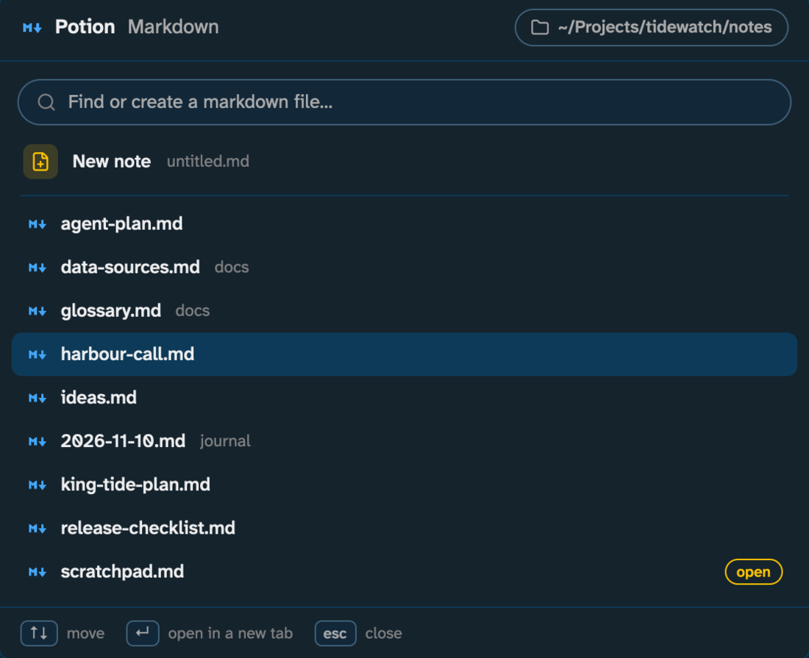
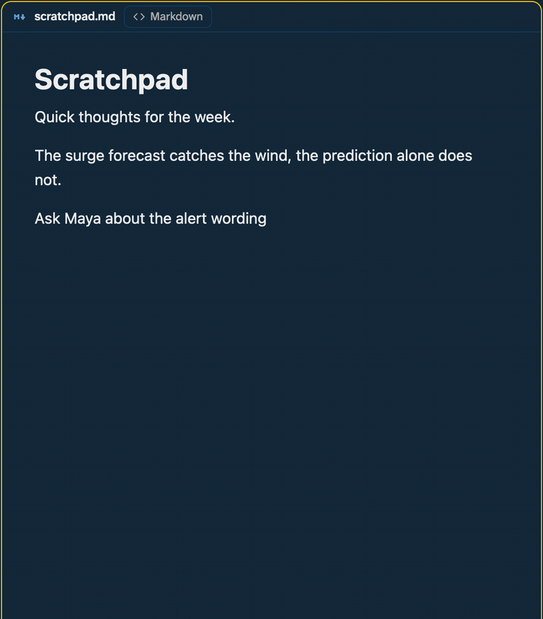
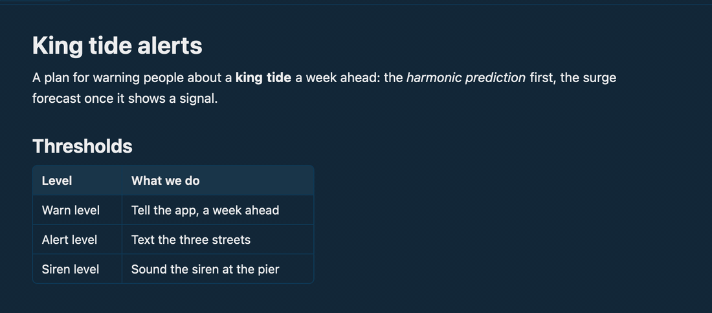
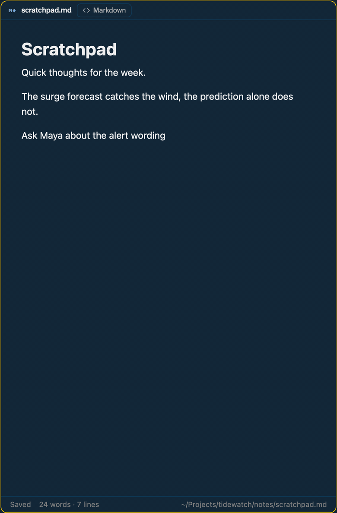
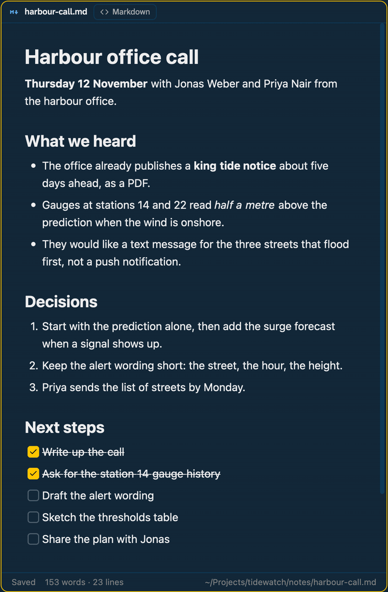

# Potion Markdown for Herdr

A Markdown editor in a Herdr pane, next to your terminals and agents. You write on the rendered page, and the file
stays plain markdown that you, your agents and any other tool can read.


_The notes and chats in these pictures are made up. [docs/REFERENCE.md](docs/REFERENCE.md) has every detail._

## Sponsor

<a href="https://thewildmagic.com">
  <picture>
    <source media="(prefers-color-scheme: dark)" srcset="docs/media/wildmagic-dark.svg">
    
  </picture>
</a>

[Wildmagic](https://thewildmagic.com) sponsors this project.

## Features

### No markdown while you write

Click anywhere on the page and type. Bold looks bold and a table looks like a table; no `**` or `|` gets in the way.
Markdown you type still works as a shortcut: `# ` makes a heading, `- ` a list, `[] ` a task, and `**word**` turns bold
when you close it. The file on disk stays ordinary markdown.


### Watch an agent's plan as it is written

Open the file an agent is writing and the page fills in as the lines land. If you are editing it too, the agent's
change is merged into yours as long as it stays clear of the part you changed. When the two touch, you pick which to
keep.


### Comments your agent can read

Select text, press Cmd+Alt+M and type. The comment shows as a card beside the text, and it is saved in the file itself
as [CriticMarkup](https://criticmarkup.com) with the time. An agent reading the file finds your note right next to the
words it is about:

```
The release {==ships on Friday==}{>>2026-11-16 20:51 | too early? QA needs a day<<} and the docs follow on Monday.
```


### Open or make a note from anywhere

Cmd+M lists the markdown files of the folder you are working in, recent ones first. Type a new name to create that file.
Cmd+Shift+M opens the file beside your current pane instead of in a new tab.



### Format from the selection

Select text and a small bar shows up: bold, italic, colours and highlight, code, links, headings and lists. The usual
keys work too.



### Blocks with a slash

Type `/` for a heading, a list, a to-do list, a table, a code block, a diagram, a picture or a divider. Keep typing to
narrow the list.


### Tables are grids

Click a cell and type. Tab goes to the next cell, and Tab in the last one adds a row. Drag the line between two columns
to resize them: the width is kept in the file as the dashes of the table's second row, so it stays a normal markdown
table.



### Tasks you can tick

Click a box to tick it.


### Diagrams on the page

Mermaid blocks are drawn as diagrams right in the note. Double-click one to edit its source.



### Code blocks

Each code block shows its language on a chip; click it to change the language. What you type in code stays exactly as
typed.


### Pictures travel with the note

Drop images from Finder, or pick one from the slash menu. A picture from somewhere else is copied into an `images/`
folder next to the note, so the note and its pictures move together.


### The source when you want it

Cmd+E shows the raw markdown, and Cmd+E again brings the page back. Your place and caret stay where they were, and
undo works across both.



### Copy and paste keep their shape

Copying keeps the formatting, as markdown. Paste an answer from a chat and its headings, lists and code arrive as
blocks, not as one lump of text.

### Good to know

- It saves as you type.
- Files on another machine open read-only for now.
- Files over 1 MiB are not opened.

## Install

```sh
./install.sh                 # the mods, their keys and the diagram renderer
./install.sh --no-mermaid    # skip the diagram renderer
./install.sh --no-keys       # leave your keys.json alone
./install.sh --replace-keys  # take over cmd-m and cmd-shift-m if you bound them to something else
```

You need Herdr 0.1.16 and Node.js (22.12 or newer for diagrams). The diagram renderer downloads about 650 MB the first
time (mermaid-cli and a headless Chrome); without it, diagrams show as code blocks. Herdr picks the mod up right away,
with no restart.

## Keys

| Keys | What it does |
|---|---|
| `cmd-m` | Opens or makes a note in a new tab |
| `cmd-shift-m` | The same, beside your current pane |
| Cmd+E | The page or its markdown source |
| Cmd+Alt+M | Comments on the selection |
| Cmd+K | Links the selection |

While `cmd-m` is bound, it replaces the macOS shortcut for minimizing a window. Every other key is in
[docs/REFERENCE.md](docs/REFERENCE.md#keys).

## Integrations

Optional patches for Herdr's own parts: a Markdown row in the `+` menu, a click on a `.md` file in the file panel, the
file name and view toggle in the pane header, and an icon on Markdown tabs. See
[integrations/README.md](integrations/README.md).

## Tests

```sh
npm test    # Node.js 22 or newer; nothing to install, and Herdr is never started
```

## License

[MIT](LICENSE). The bundled icons and the spec examples used as test data keep their own licenses, listed in
[`THIRD_PARTY_NOTICES.md`](THIRD_PARTY_NOTICES.md).
