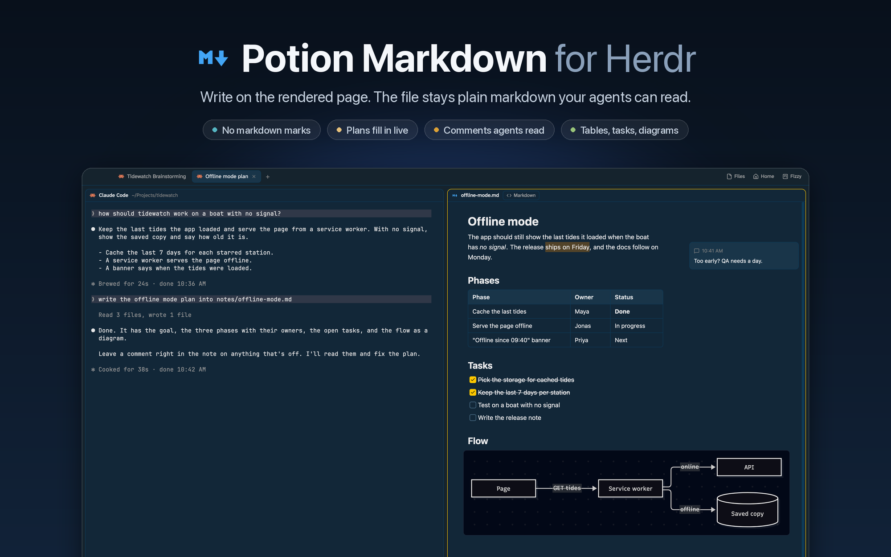

# Potion Markdown for Herdr

A Markdown editor in a Herdr pane, beside your terminals and agents. Sponsored by Wildmagic
(https://thewildmagic.com). You write on the rendered page: headings, bold, lists, tasks and tables look as they will
and no markdown marks show, while the file stays plain markdown your agents can read. Open the plan an agent is
writing and it fills in as the lines land; your own edits are merged with the agent's unless the two touch. Comments
are saved in the file as CriticMarkup with their time, so the agent finds them next to the words they are about.
Table column widths and dropped pictures stay with the file too, and mermaid blocks are drawn as diagrams. `cmd-m`
finds or makes a note in a new tab, `cmd-shift-m` beside the pane you are in.



## What you see

A Potion pane shows one markdown file. Top to bottom: the toolbar, a banner while something needs an answer, the page
(**Reading**) or the source (**Markdown**), and the footer. The pane is `background` with `foreground` text at 13 px in
the theme's sans font (`typography.sans`, else `.SystemUIFont`); code is in the terminal font (`settings().font_family`,
else `JetBrains Mono`). Colors here are theme names.

- **Toolbar**, 40 px, padding 14 across, gap 10, a 1 px `border` line under it: the 14 px Markdown file icon, the file
  name (medium, cut with an ellipsis), and at the right the **Markdown** toggle: 26 px, padding 10 (8 below 560 px of
  pane width), rounded 7, a 1 px `border` border, 12 px `muted`, a 13 px code icon and, from 560 px, the word
  "Markdown" (narrower, the tooltip "Markdown"); `hover` behind it on hover; in the Markdown view `selected` behind it
  and `foreground`. Left out while the shown layout draws its pane headers with the `my-pane` clone (the pane-header
  integration), which shows the same name and toggle.
- **Banner**, only while needed: padding 14 by 10, gap 12, `raised`, a 1 px line under it, 12.5 px. A title (medium)
  over a line of detail (12 px `muted`), and at the right 26 px buttons (padding 10, rounded 6, 12 px), the first in
  `solid` and `solid_foreground`, the second on `hover`:

  | Title | Detail | Buttons |
  |---|---|---|
  | Changed on disk | This file was saved by something else while you had unsaved changes. | **Keep mine**, **Load theirs** |
  | This file was deleted or moved | What is here is not saved anywhere else. (`Couldn't save it again: <why>` after a failed try) | **Save again** (none for a file on another machine) |
  | Couldn't save | the error | none |

- **The page** (Reading), scrolling: one column at most 780 px wide with its padding (32 across, 28 above, 160 below),
  centred in the pane. Blocks are 14 px apart, 8 after a heading, 6 between items of one list and between an item and
  what it holds:

  | Block | Look |
  |---|---|
  | Paragraph, list item, quote | 15 px, line height 1.6, `foreground` |
  | Heading 1 to 6 | 28 px bold (line height 1.25), 22 bold (1.3), 18 semibold (1.4), 16 semibold (1.5), 15 semibold (1.6), 14 semibold (1.6); 32, 28, 24, 20, 20, 20 px above it |
  | List item | a 24 px marker column, each level 24 px further in. Bullets by depth: a 6 px dot, a 6 px ring (1.5 px line), a 5 px square, in `foreground`. Numbers right-aligned at 15 px, 5 px from the text. A task is a 16 px box, rounded 4, a 1.5 px `input` border; ticked, filled with `accent` and a 12 px check in `accent_foreground`, its text struck through |
  | Quote | a 3 px `input` bar (rounded 2) at its left, the text 14 px further in |
  | Code block | a box: `surface`, 1 px `border`, rounded 8, padding 14 by 12. A 28 px strip at its top holds the language chip at the right (22 px, padding 7, rounded 6, 11.5 px `dim`, the name cut at 24 characters, a 12 px chevron when it opens the menu; `hover` behind it on hover and while its menu is open); the code under it in mono 13 px, line height 1.5, no syntax colours |
  | Table | a grid (below) |
  | Paragraph made only of images | the pictures (below) |
  | `mermaid` block | a diagram frame (below); while its source is edited, a code block |
  | Rule | 24 px high, a 1 px `border` line through its middle |
  | Front matter | a `surface` box, 1 px `border`, rounded 8, padding 12 by 10, 12 px mono `muted` |
  | HTML block | the code box, drawn by Herdr's markdown view at 14 px; an HTML comment as 12 px mono `dim` lines |
  | Link or footnote definition | its source line, 12 px mono `dim` |

  Inline, no markdown mark shows. Bold is weight 700, italic italic, `~~` struck, `<u>` underlined. A link is its text
  in `accent`, underlined. Inline code is mono at 0.87 of the text size on `surface`, rounded 3. A text colour is the
  theme's `ansi1` (red), `ansi3` (yellow), `ansi2` (green), `ansi6` (teal) or `ansi5` (purple), else `#e06c75`,
  `#e5c07b`, `#98c379`, `#56b6c2`, `#c678dd`. Highlighted (`<mark>`, `{==…==}`) and commented text sits on the
  **highlight colour**: ochre `#dca136` mixed 25 % into a grey as light as the theme's `background` (dark brown on a
  dark theme, beige on a light one); the **deep colour**, for the active comment, is the same at 45 %. A comment at a
  point shows as a highlighted 💬. A picture inside a line of text is a `muted` picture icon (0.9 of the text size) and
  its alt text in `muted`. A hard-wrapped paragraph shows its line breaks as spaces.

  - **Tables**: a 1 px `border` frame, rounded 6, clipped; the header row on `surface`, 14 px semibold; body rows 14 px;
    cells padding 10 by 6, a 1 px `border` line between rows and between columns. A column is as wide as its widest
    text, 64 to 360 px (shared out when the page is narrower, 64 each when even that does not fit), or as wide as its
    dashes say (see How it behaves); `:-:` centres a column's text, `--:` puts it at the right. A table no wider than
    the text keeps to the text's left edge (or the item's indent); a wider one is centred on the text and spreads out to
    the pane's 32 px padding on either side (with margin cards, 24 px short of them), and only beyond that scrolls
    sideways, a shade at each edge with more of it: four 3 px strips of black at alpha `26`, `18`, `0e`, `06`. With the
    pointer on a column's line (4 px either side) the line becomes 2 px in the theme's yellow under a column-resize
    cursor. A table whose rows hold more cells than its header, or of more than 1,000 cells, is no grid: it is drawn
    in the code box by Herdr's markdown view and edited as its source.
  - **Pictures**: each at its own size, shrunk to the text width and never enlarged, 8 px apart, wrapping, each row as
    tall as its tallest. Until loaded, a 40 px box (`surface`, 1 px `border`, rounded 8, 12.5 px `muted`) with a
    spinning 14 px spinner and "Loading picture…"; one that can't be shown, the same box with `<name>: <reason>`
    (`Not found`, `Not a picture Herdr can show (PNG, JPEG, GIF, WebP, BMP, SVG)`, `Over 25 MB: too big to show`,
    `Too big to show (W × H px)`, `Over 10 MB`, `Timed out`, `Web pictures need curl`, `Pictures on another machine
    aren't shown yet`). A picked picture has a 2 px `accent` ring 3 px outside it, rounded 6; a commented one a 2 px
    frame inside its edge in the highlight colour (the deep colour while its comment is active).
  - **Diagrams**: a frame, rounded 8, clipped, in fixed colours, not the theme's: a `#020817` canvas with a grid of
    `#151924` dots 30 px apart that moves with the picture, a 1 px `#1e293b` edge, the picture drawn in Mermaid's
    `redux-dark-color` theme. It is at least as wide as the text column and at most the pane less 32 px on each side
    (a frame wider than the column is centred on the pane), 120 px tall at least and 70 % of the pane's height at most,
    with 12 px of padding. It opens at the zoom that shows all of it when that is 75 % or more, else at its full width,
    never under 75 % nor over 100 %; a top-down flowchart starts at its top centre, other diagrams at their top left.
    With the pointer over it, at its top right (8 px in, kept 24 px below the pane's top while the frame's top is
    above): a − % + group, 26 px tall, cells 26, 48 and 26 px, rounded 7, a 1 px `#1e293b` border, `#0f172a` behind
    12 px `#f8fafc` text and 13 px icons (a step that can go no further in `dim`), and 6 px left of it a 26 px Comment
    button in the same look. While first drawn: a 120 px box in the canvas colour with a 1 px `#1e293b` border, a
    spinner and "Drawing diagram…" in 12.5 px `#94a3b8`. With no renderer: a `surface` box (padding 12, rounded 8)
    with "Diagrams need the mermaid renderer" (12.5 px medium), "Run install.sh in Potion's folder" (12 px `muted`)
    and the source as a code block. A syntax error: that box with "Mermaid error" in `blocked` and mermaid's message in
    12 px mono `muted`, over the last good picture at 50 % opacity.
  - **Comments in the margin**, while the file has comments and the pane is at least 836 px wide: the page (520 to
    780 px) and a 260 px column of cards are centred together, 24 px apart, at least 16 px from the pane's sides. Each
    card sits level with the row where its marked text starts: padding 10, gap 4, rounded 8, a 1 px `border`, `raised`;
    a 20 px head (a 13 px message-square icon in `dim` and the time in 11.5 px `dim`: `3:45 PM` today, `Nov 16` this
    year, `Nov 16, 2025` before; "Comment" for a comment with no time), then the comment at 13 px, line height 19 px,
    cut to three lines with an ellipsis. Cards that would overlap go down, 8 px apart, and scroll with the page. The
    active card has a 1 px border in the deep colour, a large shadow, the whole comment, and in its head two 20 px
    buttons, Edit (pencil) and Resolve (check), 14 px icons in `muted`. A code block's, diagram's, table's or picture's
    comments sit level with its top, in the order written; a table cell's beside its row.
  - **Narrower panes** show a count instead: a 40 × 22 px chip, rounded 6, a 14 px message-square icon and the number in
    11.5 px `muted` (tooltip `1 comment`, `N comments`; `hover` on hover), level with the block's first row, 10 px
    right of the text column when that leaves 12 px before the pane's edge, else inside the column at its right (left
    of a code block's chip, 4 px apart).
  - **A Comment button** (22 px, rounded 6, a 14 px message-square-plus in `dim`, tooltip "Comment (Cmd+Alt+M)",
    `hover` on hover) shows on the code block or table under the pointer and on the one being edited: 4 px left of a
    code block's chip (or of its count), or just right of a table's grid at its top, on `popover` with a 1 px `border`
    and a small shadow (inside the grid's corner when there is no room). A block whose comment is being written has a
    2 px frame in the highlight colour, one whose comment is active in the deep colour.
  - **Scroll thumb**, while the page is taller than the pane: 6 px wide, 3 px from the right, at least 28 px tall,
    rounded 3, `border` (`muted` on hover and while dragged).
  - An empty file that can't be edited says "This note is empty." in the middle, in `muted`.
- **The source** (Markdown view): the whole file in one soft-wrapped field, mono 13.5 px, at most 860 px wide, centred,
  padding 24 by 16. A file on another machine shows in a read-only code view instead.
- **Footer**, 26 px, padding 14 across, gap 12, a 1 px line over it, 11.5 px `dim`: the save state (`Saved`; `Unsaved`
  in `muted` after a 6 px `accent` dot; `Saving…` in `muted`; `Conflict`, `Deleted` or `Not saved` (its tooltip the
  error) in `blocked`; `Read-only · <machine>` or `Read-only: unusual characters` in `muted`), `N words · N lines`,
  `N comments` (in Reading, when there are any), the diagrams (`N diagrams`, then `· N errors`; `Drawing diagrams…`;
  `Diagrams need the mermaid renderer: run install.sh`; `Diagrams need Node.js`), and at the right, cut, the path with
  `~` for the home folder (`<machine>:<path>` for another machine).
- Instead of all this while the file loads, `Loading…` in the middle in `muted`; for a file that can't be read,
  `This file is over 1 MiB: too big to open here` or `Can't open this file: <why>`.

**Floats over the page**, on `popover` with a 1 px `border` and a large shadow, kept 8 px from the pane's edges. A
press on one goes no further, so the text under it keeps its selection.

- **Slash menu**, 264 px wide, rounded 10, padding 5, 12.8 px, 6 px under the caret's row (over it when 12 rows fit
  only there, else on the roomier side; filtering never flips it), its left edge at the slash. Rows 31 px, padding 8,
  gap 9, rounded 7: a 14 px icon in `muted`, the name, and what it writes as a hint (mono 11.5 px `dim`); the
  highlighted row on `hover`. Up to 12 rows show; "No results" when nothing matches. The rows: Text, Heading 1 (`#`),
  Heading 2 (`##`), Heading 3 (`###`), Bulleted list (`-`), Numbered list (`1.`), To-do list (`[ ]`), Quote (`>`), Code
  block (```` ``` ````), Mermaid diagram (`mermaid`), Image (``), Table (`|`), Divider (`---`).
- **Format bar**, 6 px over the selection's first row (under its last when there is no room), its left edge at the
  selection's start: rounded 10, padding 4, 28 px square buttons (a menu's 12 px wider for its 10 px `dim` chevron),
  rounded 6, 16 px icons in `muted`; groups parted by 1 × 16 px `border` rules 9 px wide: **Comment** |
  **Text style** ▾ (the block's style as its icon: type, heading-1/2/3, text-quote) | **Bold**, **Italic**,
  **Underline**, **Strikethrough**, **Code** | **Colour** ▾ (the palette icon in the selection's colour, on its
  highlight) | **List** ▾ (the block's list as its icon) | **Link**. A mark every letter has shows its icon in `accent`
  on `hover`. Tooltips: "Comment (Cmd+Alt+M)", "Text style", "Bold (Cmd+B)", "Italic (Cmd+I)", "Underline (Cmd+U)",
  "Strikethrough (Cmd+Shift+X)", "Code (Cmd+Shift+C)", "Colour", "List", "Link (Cmd+K)". In a table cell Text style
  and List are left out. Too narrow for one row, it wraps between groups, rows 2 px apart.
- **Bar menus**, 220 px, rounded 8, padding 4, 4 px under their button, 12.8 px: 28 px rows (a 14 px icon or a 16 px
  swatch rounded 4, the name, a 14 px check on the current one), titles 26 px in 11.5 px `dim`. Text style: Text,
  Heading 1, Heading 2, Heading 3, Quote. List: Bulleted list, Numbered list, To-do list. Colour: under **Text**,
  Default (a `foreground` swatch), Red, Yellow, Green, Teal, Purple; under **Highlight**, No highlight (a dashed
  `muted` outline) and Yellow (the highlight colour).
- **Link popover**, over the link's row, its left edge at the link's start, rounded 8, padding 4, 12.5 px: the address
  in `muted` (cut in the middle past 40 characters, the whole one as its tooltip), a rule, then four 28 px buttons with
  16 px `muted` icons: Open link (external-link), Copy link (copy; a check and "Copied" after), Edit link (pencil),
  Remove link (unlink).
- **Address box**, in the popover's place: 340 × 40, padding 6, rounded 8, a one-line 13 px field, "Paste or type a
  link".
- **Picture menu**, over the picked picture (under it at the pane's top), in the link popover's look: the address as
  written in the file, a rule, then Comment (message-square-plus), Change picture (image-up), Alt text (type), Copy
  address (copy, then a check), Open picture (external-link), Open link (link, on a linked picture only), a rule,
  Delete picture (trash-2). A file that can't be edited gets Copy address, Open picture and Open link only; an HTML
  `` no Comment, Change picture or Alt text. Its boxes, in the address box's look: "Describe the picture" and
  "Paste a picture address or path".
- **Language menu**, 220 px, 4 px under the chip with their right edges aligned (over it when only that side has
  room), rounded 8, padding 4: a 32 px field "Search or type a language", then up to 12 rows of 28 px (the name, a
  check on the block's own, the highlighted one on `hover`). With nothing typed: Plain text, Bash, CSS, HTML,
  JavaScript, JSON, Markdown, Mermaid, Python, Rust, TypeScript, YAML. A word that is no language adds `Use “<word>”`.
- **Comment box**, where no margin shows the cards (a narrow pane, or a file's first comment): 320 px wide, at least
  44 high, padding 6, rounded 8, a 13 px field "Add a comment…" growing to 12 rows; where the format bar goes, or over
  a block's top edge, or in a picture menu's place.
- **Comments card**, from a count chip, under it with their right edges aligned (over it when only that has room):
  300 px, padding 10, gap 10, rounded 8, 12.5 px; for each comment the marked text (`muted`, cut at 80 characters), the
  time (11.5 px `dim`), the comment, and **Edit** and **Resolve** (24 px, padding 8, rounded 6, on `hover`; left out in
  a file that can't be edited).
- **Comment float**, from a click on commented text in a narrow pane: a margin card on `popover` with its deep-colour
  border, over the text.

**The picker**, Herdr's dialog overlay, 560 × 460, `popover`, 13 px:

- **Header**, 46 px, padding 14, gap 8, a 1 px line under it: the 16 px Markdown icon, "Potion" (14 px semibold),
  "Markdown" (14 px `muted`), and at the right the folder as a 26 px round pill (a 1 px `input` border, padding 10,
  gap 6, a 13 px folder icon, 12 px medium `muted`, at most 300 px, cut; `<machine>: <folder>` on another machine;
  the same as its tooltip).
- **Search**, 12 px in (12 above, 6 below): a 32 px round field, a 1 px `input` border (`accent` once it has words),
  `background`, 13 px, padding 34 at the left with a 14 px search icon in `dim`, "Find or create a markdown file…";
  while it has words, a round 20 px **x** 6 px in from the right (a 12 px icon in `dim`; `hover` and `foreground` on
  hover; tooltip "Clear").
- A note line (12 px, padding 16) when nothing matches and the words make no usable name (`dim`: `Type a name`, `Use a
  name inside this folder`, `Add a file name after the folder`, `A name can't go up with ..`, `That name can't be
  used`) or when creating failed (`blocked`: `Can't create <name>: <why>`).
- **The row that makes a file**, above the list and never scrolled: 38 px, 8 px in, padding 8, gap 10, rounded 8,
  12.8 px: a 24 px square (rounded 6, `accent` at 16 % alpha) holding a 14 px file-plus in `accent`, then **New note**
  (medium) and in 11.5 px `dim` the name it will get (`untitled.md`, else `untitled-2.md` …); or, for a typed name no
  listed file has, **Create** and the name (semibold `accent`). On another machine it is `dim` and says `Creating
  files on <machine> isn't supported yet`. A 1 px `border` line under it, 14 px in.
- **The list**, 8 px in: rows 30 px, padding 10, gap 9, rounded 7, 12.8 px: a 15 px Markdown icon, the file name
  (medium, at most 300 px), its folder (11.5 px `dim`) and at the right an 18 px pill (padding 7, 10.5 px medium):
  `open` (a 1 px `accent` border, `accent` text) for a file shown in a Markdown pane of the focused tab, `recent`
  (`raised`, `muted`) for a recent one. The highlighted row is `selected`. States as a 30 px row in 12 px `dim`:
  `Looking for markdown files…`, `No markdown files here`, and `Can't list this folder: <why>` in `blocked`.
- **Footer**, 36 px, padding 14, gap 14, a 1 px line over it, 11 px `dim`: three keys, each an 18 px cap (at least
  18 wide, padding 5, rounded 5, a 1 px `input` border, `background`, 10.5 px medium `muted`) and what it does: `↑↓`
  move, `↵` open in a new tab (`open beside` from `cmd-shift-m`), `esc` close.

**Open as new tab**, the 200 × 44 popup the file-panel integration opens on a right-click: `popover`, padding 5, one
31 px row on `selected` (padding 8, gap 9, rounded 7, a 14 px plus in `muted`, "Open as new tab" at 12.8 px).

## How it behaves

- **The picker.** It lists the markdown files (`.md`, `.markdown`, `.mdown`, `.mkd`, `.mkdn`, `.mdx`) of the folder
  of the pane focused when it opened: a Markdown pane's file's folder, else that pane's folder, else the space's, else
  the home folder, on the space's machine. Recent files of that machine (the last 30 opened, any folder; outside the
  folder shown with `~`) come first, and a recent file deleted since leaves the list and the saved list. Typing
  filters: a match in the name before one only in the path, a run of the letters before scattered ones, earlier
  before later, shorter paths first; at most 200 rows. The highlight starts on the best file not already shown in
  this tab; Up and Down move it (wrapping), the pointer takes it when it moves, the wheel scrolls; Enter or a click
  opens; Escape closes. New note writes an empty `untitled.md` (`untitled-2.md` … when taken) in the folder; Create
  writes the typed name (`.md` added when it has no markdown extension), making its folders with `mkdir -p`; either
  opens it at once. One picker is open at a time: one that opens closes the other, and `cmd-shift-m` with its own
  picker open closes it.
- **Where a file opens.** For a new tab (`cmd-m`): the tab that already shows the file in Markdown panes only, in any
  space, is selected; else a tab named after the file opens in the active space. Beside (`cmd-shift-m`, a link in a
  note, the file panel's click): the pane of that tab already showing the file gets the focus; else, for
  `cmd-shift-m` and links, the tab's newest corner splits: the last pane down the tab's split tree, across its row or
  column, so panes spiral inward and the first keeps its half. `beside.js` reads that tree from herdr-core's
  `herdr-app` document, which Herdr does not document; when it can't, and for the file panel's click, the pane splits
  to the right. With no pane to split it opens a tab.
- **Reading is the editor.** Each file opens in the view it was last in (Reading the first time); a new or empty note
  opens with the caret in an empty paragraph. A click puts the caret where you click and nothing on the page moves:
  the text blocks near the view are drawn by text fields whether edited or not, each formatted word one token that
  holds its hidden marks and draws what Reading shows. The caret stops between a formatted word's letters only once
  you click or arrow into it. A click beside the page stops editing, one below the last block starts a paragraph at
  the end, and Enter with nothing edited picks up where you were. With nothing edited, Up and Down scroll 48 px, Page
  Up, Page Down and space a page less 40 px, Home and End to the ends.
- **Typing markdown** works as a shortcut: `# ` to `###### ` a heading, `- `, `* ` or `+ ` a bullet, `1. ` or `1) ` a
  numbered item, `[] ` or `[ ] ` a task, `> ` a quote (Cmd+Z right after gives back what you typed); `**word**` turns
  bold as you close it; ```` ```js ```` then Enter opens an empty code block, `---`, `***` or `___` then Enter a rule.
  Text typed inside a formatted word takes its formatting, right before or after it is plain; a character that would
  make hidden marks show is written so it shows as typed. A block opened and left empty writes nothing.
- **Keys in text.** Enter splits the block, both halves keeping their formatting (a list continues; on an empty item,
  out a level, then out of the list); Shift+Enter is a line break, written `\`. Backspace at the start turns a heading
  or quote into a paragraph, moves an item out a level, or joins the paragraph above, every letter keeping its look.
  Tab and Shift+Tab nest and un-nest an item with its sub-items; Option+Up and Down move the block; Cmd+Enter ticks
  the task. Cmd+B, Cmd+I, Cmd+U, Cmd+Shift+X, Cmd+Shift+C and Cmd+Shift+H put bold, italic, underline,
  strikethrough, code or a highlight on every letter of the selection, or take it off when every letter has it; on a
  caret in a word they act on the word, elsewhere they set what is typed next. Cmd+K opens the address box, offering
  a web or mail address the clipboard holds; Cmd+Alt+M comments. Arrows go on into the next block at an edge; Page Up
  and Down scroll a page and take the caret; Escape closes the innermost float, else stops editing.
- **The format bar** shows over a selection holding more than spaces and stays for the next mark, until the
  selection goes, you type, press Escape or click elsewhere; a right-click on selected text shows it too. Text style
  turns the block into a paragraph, heading 1 to 3 or quote; List into a bulleted, numbered or to-do item (the
  checked list turns it back into text); Colour sets or clears a text colour and the highlight. Each pick is one undo
  step and leaves the same text selected.
- **What the file gets.** Bold `**…**`, italic `*…*`, strikethrough `~~…~~`, code `` `…` ``, and `<strong>`, `<em>`
  or `<s>` where markdown can't open or close a mark at that spot; underline `<u>…</u>`, highlight `<mark>…</mark>`,
  colour `<span style="color: red">…</span>` (red, yellow, green, teal, purple). A `<mark color="…">` written by hand
  keeps its colour. A list item made from the bar's List menu gets one space after its marker (`- [ ] `).
- **Code.** Typing stays as typed: no formatting, shortcut or slash menu. Enter keeps the line's indent; Tab types the
  block's indent (a tab, else its smallest indent of 2 spaces or more, else 4 spaces), and with a selection indents
  every line it touches, Shift+Tab taking one indent off. Three Enters after the last line (the two blank lines go),
  Cmd+Enter, Down on the last row or Right at the very end leave the block. A typed line that would close the fence
  early makes both fences longer. A click on the chip opens the language menu without opening the block: typing
  narrows it (names and aliases such as `py`, `sh`, `ts`), Up, Down, Enter or a click picks, Escape closes. A pick puts
  the language's id (`bash`, `c`, `cpp`, `csharp`, `css`, `diff`, `go`, `html`, `java`, `js`, `json`, `kotlin`,
  `markdown`, `mermaid`, `php`, `python`, `ruby`, `rust`, `sql`, `swift`, `toml`, `ts`, `xml`, `yaml`) in place of the
  info string's first word and keeps the rest; Plain text removes the info string; an indented block becomes a fenced
  one; Mermaid makes the block a diagram, and another language makes a diagram a code block again.
- **Tables.** A click puts the caret in the cell where you click; you type there as in a paragraph (format keys, the
  bar, links, comments). A cell holds one line: a pasted line break becomes a space, a typed `|` is written `\|`. Tab
  and Shift+Tab select the next or previous cell's text, header row first, and Tab in the last cell adds a row; Enter
  goes to the end of the cell below, on the last row adds one; Cmd+Enter leaves for a paragraph below; arrows cross
  cells and leave the table at its edges; Backspace at a cell's start and Delete at its end do nothing. A new row is
  padded to line up when the table's pipes line up, else written `|  |  |`. While the caret is in a table its columns
  keep their widths. Shift+wheel or a sideways swipe over a wide table scrolls it.
- **Column widths.** Drag a column's line: the column on its left grows or shrinks (never under 64 px), the columns on
  its right move with it, and a centred table grows on both sides so the line stays under the pointer. Nothing is
  written while you drag. On letting go only the delimiter row changes, each column getting as many dashes as its
  width holds letters of the table's text, less its 20 px of padding; colons, pipes and spaces stay, and other rows
  are left as they are. One Cmd+Z puts it back, Escape during the drag cancels, a double-click on a line fits the
  column to its text. A table whose columns all have three dashes or fewer takes its widths from its text, and its
  first resize writes every column's width as it looked.
- **Links.** A click selects the whole link and shows its popover; a second click puts the caret in its text; Cmd+click
  opens it (in a file you can't edit, a plain click does). `http` and `https` open in the browser, `mailto` with `open`
  (`xdg-open` off macOS), another markdown file in a pane beside, on the same machine; `#anchor` does nothing; another
  file says `Can't open <name> here`. In the address box Enter applies (an empty box removes the link) and Escape goes
  back to the popover; a bare host gets `https://`, and an address with a space or an unpaired parenthesis is written
  in `<…>`. Remove leaves the text, selected.
- **Comments.** Select text and press Cmd+Alt+M or Comment: the text keeps a highlight and a card "Add a comment…" opens
  beside it; Enter writes `{==text==}{>>YYYY-MM-DD HH:MM | comment<<}` (local time, 24-hour), Escape or Enter with
  nothing typed drops it. With no selection it is a comment at the caret, `{>>…<<}`. A click on a card or on commented
  text makes its comment active (the text selected, the deep colour, the card's buttons); Edit, or a click on the
  card's text, edits it in place (Enter keeps the time; an emptied comment resolves); Resolve takes the marks off and
  leaves the text selected. Each is one undo step. A comment is one line (a line break becomes a space, `<<}` is
  written `<< }`), stays in one paragraph and out of code, and never cuts through another: `A comment can't cut
  through another one`, `Comments can't go in code`, `A comment stays within one paragraph`. A code block, diagram or
  table takes comments from its Comment button (or Cmd+Alt+M while it is edited): point comments one per line in a
  paragraph right after it, a blank line between, which Reading never draws and which moves and goes with the block.
  A cell's comment goes in the cell, every `|` in it written `\|`. A picture's goes around its markdown, one per
  picture: `{====}{>>…<<}`. Comments written by hand or by an agent in these forms read the same.
- **Slash menu.** `/` at the start of a block or after a space opens it; typing narrows it (`/h2`, `/todo`, `/img`,
  `/mer`); Up, Down, Enter, Tab or a click picks; Escape closes it keeping what you typed. A text style changes the
  block; the others add a block where the slash was, or take the place of a block holding nothing else: a table of
  three columns with "Column 1" selected, a starter flowchart (`flowchart TD`, `A[Start] --> B[End]`). Cmd+Z right
  after a pick gives back what you typed. No menu in code, table cells or a diagram's source.
- **Pictures.** Image opens the macOS file dialog (PNG, JPEG, GIF, WebP, BMP, SVG; several at once), in the folder the
  last picture came from, else `~/Desktop`, and it stays open as long as you need. Image files dropped from Finder go
  below the block under the pointer, else the one edited, else at the end (anything else: `Only pictures can be
  dropped here (PNG, JPEG, GIF, WebP, BMP, SVG)`). A picture in the note's folder or below it is linked where it is;
  any other is copied into `images/` beside the note (whitespace in its name turned to `-`; `-2`, `-3` … when the
  name holds other bytes; the same bytes linked without a copy), and written ``,
  one per line, as one paragraph. A click, double-click or right-click picks a picture: Backspace or Delete deletes
  it, Left and Right pick its neighbours, Enter starts a paragraph below, Cmd+C and Cmd+X copy and cut its markdown,
  Escape lets it go. Change picture opens the dialog for one file; Alt text edits the alt; Copy address copies a file's
  full path; Open picture runs `open` (`xdg-open`), a web picture in the browser. Addresses may be a relative or
  absolute path, `file://`, `https://` (downloaded when the file opens) or `data:image/…`; `http://` and other schemes
  show an error box. Without `osascript`, Image writes ``, picks it and opens the address box.
- **Diagrams.** A `mermaid` block is drawn once per text and renderer version and kept in
  `<appHome>/data/potion/diagrams/`; the page's diagrams go to the renderer together, 8 at a time, 400 ms after the
  last one asked. A diagram is drawn again when you leave its edited source. Drag or swipe sideways to move it;
  scrolling over a diagram taller than its frame brings the frame into view, scrolls the picture to its end, then the
  page goes on; Cmd+scroll or Ctrl+scroll zooms around the pointer, from the whole diagram to 200 %; − and + step the
  zoom, the percentage goes back to where it opened. Zoomed past what the picture was drawn for, a sharper one is drawn
  once, 300 ms after the zoom rests, and laid over it. A double-click opens the source (a single click does nothing).
  Each frame keeps its view while you edit elsewhere. A failed run (no Node.js, a crash, a time-out) is tried again
  after 15 s; a missing renderer is looked for again every 10 s, so `install.sh` works without reopening the pane.
- **Selecting blocks.** A drag across blocks or Shift+click selects whole blocks (`selection` behind them): Cmd+C,
  Cmd+X, Backspace and Delete act on them; Escape or a click clears.
- **Copy and paste.** Cmd+C copies the selection as markdown that stands alone (part of a bold word bold, part of a
  link a link to its address; comments left out, their text kept). Pasted markdown arrives as blocks; pasted into
  text it keeps its own formatting and takes the formatting where it lands.
- **Undo.** Cmd+Z and Cmd+Shift+Z undo and redo everything, in Reading and Markdown and across switching, with the
  caret and selection put back; up to 200 steps or 2 MiB, typing within a second grouped.
- **Markdown view.** Cmd+E from anywhere in the pane, or the toggle, switches; the source opens on the line you were
  editing, and back in Reading the block holding the source's caret is edited. Unsaved text is saved on each switch.
- **Saving.** 700 ms after the last change, on Cmd+S, on each switch, and when the pane or tab closes. Every write
  names the text last read from the file and is refused when the file holds something else.
- **When the file changes.** The note's folder is watched (not the home folder or `/`: then the file is read every
  4 s, as when watching fails). With nothing unsaved the page takes the new text, so a plan an agent writes renders as
  it goes. With unsaved edits their change is merged into yours and saved when the two lie apart; when they overlap or
  touch, the banner offers **Keep mine** (writes yours over theirs) and **Load theirs**. A deleted or moved file gets
  its banner, and Save again writes the text back. A picture file the watcher reports is read again and swapped in.
- **Another machine.** A file on another machine opens read-only in Reading, is read again every 5 s, and a click
  never edits; its pictures are not shown, except web ones.
- **Commands.** `potion.save`, `potion.toggle`, `potion.reading`, `potion.markdown` and `potion.focus` reach a shown
  pane.

## Built from

- **Herdr** 0.1.16 or newer (the mod reads the selection of its text fields). No layout change: both mods are
  `"place": "none"`, and a file opens with `tab.new` or `pane.split` given `mod: "potion"` and
  `props: { file: "/absolute/path.md", machine }`.
- **Mods.**
  - `potion` (`mod.json`: `{ "place": "none", "title": "Potion", "focusable": true, "overlay": { "kind": "dialog",
    "width": 560, "height": 460 } }`): one class (`main.js`) whose role comes from its `props`. `action: "open"`
    (`place: "tab" | "pane"`, optional `folder`, `machine`, `space`), or an overlay with no other props (what
    `mod.open` gives), is the **picker** (`picker.js`); `action: "menu"` (`file`, `machine`, `space`) the **Open as new
    tab** popup (`menu.js`); a `file` the **editor** (`editor.js`). With no props at all (`herdr-app check`) the editor
    opens a built-in fixture holding every kind of block with every float open. Each block is a `View` entity (`Block`)
    inside a `Column` entity (`page.js`). The pure parts import neither `herdr` nor `gpui-*`: `blocks.js` (CommonMark
    0.31 blocks, GFM tables and task items, footnote definitions; every edit one splice of the source), `inline.js`
    (inlines as markdown-rs reads them, GFM strikethrough and autolinks, CriticMarkup, inline HTML), `tokens.js` (the
    field's tokens), `restyle.js`, `mend.js`, `seams.js` and `format.js` (marks, keys, splits, joins, copy and paste
    that keep formatting), `links.js`, `comments.js`, `blocknotes.js`, `tables.js`, `grid.js`, `geometry.js` (every
    size and place), `history.js` (undo and the merge), `slash.js`, `languages.js`, `colors.js`, `imagesize.js`,
    `entities.js`, `lib.js`. Then `open.js`, `diagrams.js`, `images.js`, `pick.js` and `keys.js`.
  - `potion-beside` (`{ "place": "none", "title": "Potion beside", "overlay": { "kind": "popup", "frame": "none",
    "width": 2, "height": 2 } }`): `cmd-shift-m` opens it as an unseen popup; on its first timer tick it closes itself
    and opens `{ mod: "potion", kind: "dialog", width: 560, height: 460, props: { action: "open", place: "pane" } }`,
    or, when `potion.picker` names the picker it opened last (kept on `globalThis.herdrInlineMarkdownBeside`), closes
    that one instead.
- **Keys.** `keys.json`: `{ "global": { "cmd-m": "mod.open:potion", "cmd-shift-m": "mod.open:potion-beside" } }`,
  merged into the person's by `install.sh`. The editor binds the rest itself with `cx.bind_keys`, in contexts named
  with a version (`MdText11`, `MdRaw11`, `MdSource11`, `MdNote11`, `MdLang11`, with `rows == one` and `menu == open`):
  enter, shift-enter, cmd-enter, tab, shift-tab, up, down, pageup, pagedown, alt-up, alt-down, cmd-v, cmd-c, cmd-x,
  cmd-b, cmd-i, cmd-u, cmd-shift-x, cmd-shift-c, cmd-shift-h, cmd-k, cmd-alt-m, cmd-z, cmd-shift-z, and backspace,
  left, right and escape where the field gives them away. Cmd+S and Cmd+E come from the root's key-down.
- **Shipped mods it relies on.** None. Optional patches in `integrations/`, each applied to a clone made with
  `herdr-app do mod.clone` and pointed at by the layout, made against Herdr 0.1.12's shipped mods: `tabs/`
  (`my-tabs`: a tab of Markdown panes shows the Markdown icon and is called "Markdown" until named), `files/`
  (`my-files`: a click on a markdown file opens it beside, Shift+click in a tab, a right-click the Open as new tab
  popup), `pane-header/` (`my-pane`: a Markdown pane's header shows its file name and the Markdown toggle, through
  `potion.heads` and `potion.toggle`), `new-menu/` (`my-new-menu`, and a one-line change to `my-tabs`: a Markdown row
  in the `+` menu, key `m`).
- **`herdr` functions.** `props`, `theme`, `settings` (`zoom`, `font_family`), `home`, `appHome`, `window`
  (`platform`), `focused`, `panes`, `spaces`, `machines`, `layout`, `shared`, `setShared`, `exec` (with `cwd` and
  `on`), `readTextFile` (with `on`), `writeTextFile(path, text, expected)`, `watchFolder`, `nextCommand`, `notify`,
  `run`, `openOverlay` and `closeOverlay`; Node's `fs/promises` (`readFile`, `writeFile`, `mkdir`, `readdir`,
  `unlink`, `exists`), `buffer` and `crypto` (`createHash`). From `gpui-kit`: `View`, `div`, `svg`, `image`, and on
  elements `on_drop` (the dropped paths), `on_size_change`, `on_scroll_wheel`, `on_mouse_down_out`, `spin`,
  `cursor_col_resize`. From `gpui-base`: `v_flex`, `h_flex`, `Input` and `InputState`, `Textarea` and `TextareaState`
  with tokens (`.token(…)` draws them, `on_token_click`, `set_value({ text, tokens })`, `tokens()`,
  `selected_range`, `set_selected_range`, `set_auto_grow`, `set_soft_wrap`; the `change`, `submit`, `focus` and `blur`
  events), `TextView.markdown` (blocks away from the view, read-only files, HTML blocks), and `Editor` with
  `EditorState` (the read-only source of a file on another machine). From `cx`: `focus_handle`, `timer.after`,
  `timer.every`, `spawn`, `notify`, `new`, `bind_keys`, `write_to_clipboard`, `read_from_clipboard`, `open_url`,
  `theme().typography.sans`.
- **Commands.** `tab.new`, `pane.split` (`direction: "right"`), `pane.focus`, `space.select`, `tab.select`.
- **Shared state.** `potion.panes` (pane id → `<machine>:<path>`), `potion.recent` (the last 30 files), `potion.modes`
  (each file's last view, the last 200), `potion.picker` (the open picker's overlay), `potion.imageFolder` (where the
  last picture came from); for the pane-header integration `potion.heads` and `potion.toggle`. On `globalThis`:
  `potion.keys.11` and `potion.keys.rebound`.
- **Files it writes**, all on this computer: the file being edited; a new note; `<appHome>/data/potion/diagrams/`
  (`<key>.mmd`, `<key>.png`, `<key>.json`, `config-<hash>.json`); `<appHome>/data/potion/images/` (every picture
  shown, named by the first 16 hex digits of its SHA-256, and for a moment the dialog's `pick-*` answer files and
  `web-*.part` downloads); `images/<name>` beside a note.
- **Programs.** `git ls-files -co --exclude-standard -z` in the folder (at most 2,000 files), else `sh -c` running
  `find . -maxdepth 5` that prunes `node_modules`, `.git`, `Library`, `.cache` and hidden folders (at most 1,000), on
  the space's machine; there also `sh -c 'printf %s "$HOME"'` and `sh -c` checking that recent files still exist;
  `mkdir -p`; `curl -sSfL --proto =https --proto-redir =https --max-time 20 --max-filesize 10485760` for web
  pictures; `find <images> -type f -mtime +45 -delete` once per Herdr run; `sh -c` starting `osascript` in the
  background (`choose file … of type {"public.png", "public.jpeg", "com.compuserve.gif", "org.webmproject.webp",
  "com.microsoft.bmp", "public.svg-image"}`, with multiple selections for Image), then `kill -0` about every 2 s and
  `kill` when the pane closes; `cp`; `open` on macOS, else `xdg-open`; and the renderer.
- **The diagram renderer** (optional: without it a diagram shows as its code block and the footer says why).
  `tools/mermaid/`: `package.json` pinning `@mermaid-js/mermaid-cli` 12.2.0, its lock file, and `render.mjs`, run as
  `<node> ~/.local/share/potion/mermaid/render.mjs --config <file> --outdir <dir> [--scale <s> --background
  transparent] <key>.mmd …`. It draws every input with one `chrome-headless-shell` (puppeteer, `headless: "shell"`),
  4 at a time, at scale 2, again at the largest quarter scale under 16,000 px a side when bigger; writes `<key>.png`,
  then `<key>.json` (`{ ok, width, height, scale }`, or `{ ok: false, error }` with mermaid's message without the
  browser's stack frames), each through a rename; prints one line, `{"results":[…]}`; stops after 25 s (`Timed out`,
  not cached); exits 2 when the browser doesn't start; and deletes cache entries older than 45 days. The config:
  `theme: "redux-dark-color"`, `htmlLabels: false`, `useMaxWidth: false` for every diagram type.
- **`install.sh`** (`--no-mermaid`, `--no-keys`, `--replace-keys`, `--help`; `HERDR_APP_HOME`, `HERDR_MERMAID_HOME`):
  copies `mods/potion` and `mods/potion-beside` into `${HERDR_APP_HOME:-~/.config/herdr-app}/mods/` (a first install
  staged in a hidden folder there and renamed into place whole; later runs remove files gone from the repo and save a
  copy that differed under `${XDG_STATE_HOME:-~/.local/state}/potion/backups/<time>/`); merges `keys.json` with
  `node tools/merge-keys.mjs` (a missing key added at the end of its section, one bound to something else kept and
  named unless `--replace-keys`, every other byte kept, the old file backed up; it never makes a `keys.json`); and
  installs the renderer in `~/.local/share/potion/mermaid`: with Node.js 22.12 or newer, `npm ci --ignore-scripts`
  (only when the lock file changed or `node_modules` is gone), `node node_modules/puppeteer/install.mjs` for
  `chrome-headless-shell`, then `node-path` (where `node` is) and, last, `version`
  (`mmdc-<pin>+<8 hex of render.mjs>+<8 hex of the lock file>`, the diagram cache's key).
- **Art.** Lucide icons in `mods/potion/` (24×24, `stroke="currentColor"`): bold, check, chevron-down, code, copy,
  external-link, file-plus, folder, heading, heading-1, heading-2, heading-3, image, image-up, italic, link, list,
  list-ordered, list-todo, message-square, message-square-plus, minus, palette, pencil, plus, search, strikethrough,
  table, text-quote, trash-2, type, underline, unlink, workflow, x. Drawn for the mod: `spinner.svg` (a ring that
  spins) and `dots.svg` (a 240 px tile of dots 30 px apart, the diagram canvas's grid). `file-markdown.svg` is the
  Material Icon Theme's markdown icon (32×32, `#42a5f5`), drawn with `image()`.

## Watch out

- **The file is the truth.** `writeTextFile(path, text, expected)` writes only over the text the pane last read. A
  refusal is looked into: the file holds ours (saved), nothing (deleted), the text expected (a real write error), or
  other text (their change: merged, or the banner). A look made while a write is out is made again once it answers.
  `readTextFile` answers `null` for a missing file.
- **The merge is one range a side.** Each side's change runs from its first changed character to its last, so an
  agent's edits both above and below yours count as overlapping and bring the banner; an append below your edit
  merges.
- **Herdr's text field has no `set_tokens`.** `set_value({ text, tokens })` sets both, and the change event it sends,
  of the same text, would read as a forward Delete at the end, so for 100 ms such an event is taken as the set's. A
  token's text or label can't hold a control character or a line separator, no token edge may fall inside a
  character, and a token that draws nothing needs an invisible label.
- **A lone UTF-16 surrogate makes `set_value` throw**: such a file opens read-only.
- **Fields are dear.** A text block gets a field of its own within one screen of the view and lets it go past three;
  table cells the same, a few rows at a time. A page of more than 400 blocks mounts only what is within 1,500 px of
  the view. Herdr's runtime has no JIT and an object costs microseconds, so the inline reader keeps text in typed
  arrays.
- **Row heights are measured.** A field and Herdr's markdown view draw the same style at different heights, so
  samples ("Ag", one and three rows of each style) are drawn out of sight and measured at start and after any theme,
  font or zoom change, given up on after 2 s. A draw may not act (`cx.notify()` throws in a draw): work a draw finds
  is scheduled with `cx.timer.after`.
- **`mod.open` gives a mod no props but its overlay**, so one key can't say tab or pane: hence `potion-beside`. Mods
  can't import each other, so it repeats the dialog's spec and `potion.picker`, and each integration carries its own
  copy of what it needs (the `files` patch a copy of `openMarkdown`); the patches spell `potion`, `my-tabs`,
  `my-new-menu` and `my-pane`.
- **Herdr never answers a call made for a view that has gone**: the picker starts its listing from its own timer,
  since `potion-beside` makes it inside a timer and then closes.
- **`panes()` doesn't say what a mod pane shows.** Each editor files its pane in `potion.panes` on its first draw (only
  a draw knows: Herdr draws a copy only while its tab shows). A tab restored in the background is found by its name.
- **Herdr drops every key a mod bound each time it reads `keys.json` again**: the editor watches the app folder and
  binds its table again 500 ms after `keys.json` changes, once for all panes. Bindings can't be removed, so any change
  to the table raises its version, which is part of every context's name.
- **`exec` stops a program after 30 s**: the picture dialog runs `osascript` detached, writes its answer to files in
  the picture cache, and is polled every 300 ms.
- **`image()` draws only files under the app folder**: every picture is copied into the cache, its kind and size read
  from its first bytes, never its name. `fetch()` gives no body bytes, so web pictures come through `curl`.
- **Watching.** `watchFolder` on the home folder or `/` would wake for everything, so those are polled. The watcher
  may spell a folder differently (`/private/var` for `/var`), so a path with the file's name counts too.
- **Closing.** Herdr allows about 250 ms, so a write under way isn't awaited: the text is written over the one being
  saved, then over the last read, never more than two writes.
- **Cmd+Alt+M arrives as `alt-cmd-m`**: it is told by its key and modifiers.
- **Diagrams are not in the theme's colours**: the mermaid theme and the canvas are fixed and dark.
- **Herdr's PATH is short**, so `install.sh` writes where `node` is. puppeteer 25 needs Node.js 22.12;
  `--ignore-scripts` keeps puppeteer from fetching full Chrome; its browser installer exits 0 when the download
  failed, so its output is searched for `download failed`. The renderer takes about 440 MB of `node_modules` and
  200 MB of browser.
- **Herdr docks a new mod into the shown layout the first time it sees its folder** unless `mod.json` says otherwise,
  and a folder filled file by file can be seen before its `mod.json`: a first install appears whole. Herdr writes
  `*.d.ts`, `jsconfig.json` and `*.error` into mod folders: never copied or removed.
- **`cmd-m` is macOS's minimize** while it is bound.
- **Limits:** 1 MiB a file (`readTextFile`); from 200 KiB Reading says `Loading…` while the page is parsed in 20 ms
  slices; 2,000 or 1,000 listed files; 30 recent files; 200 remembered views; 1,000 cells a grid; columns 64 to 360 px
  until dragged, never under 64; 25 MB and 50 megapixels a picture, 10 MB and 20 s a download; 4 pictures loading at
  once; 8 diagrams a batch, 25 s a run; frames zoom to 200 %.
- **Not built:** syntax colours; editing a file on another machine, or its pictures but web ones; creating files on
  another machine; selecting from the middle of one block to the middle of another (whole blocks only, else the
  Markdown view); drag handles; jumping to `#anchor` links; footnotes (a reference stays text); drawing an HTML ``
  or a reference-style image as a picture (an icon and its alt text); a `<span>`'s colour in blocks Herdr's markdown
  view draws; CriticMarkup suggestions (`{++ ++}`, `{-- --}`, `{~~ ~> ~~}`, shown as written); the picture dialog off
  macOS. Input methods that compose characters may misbehave with Enter and around formatted words.
- **Assumes** `git` or `find` and `sh` on the space's machine; `curl` for web pictures; macOS for the picture dialog
  (`osascript`); `node` for the key merge and the renderer.

## Done when

- `herdr-app check` passes for `mods/potion` (its fixture draws) and `mods/potion-beside`.
- `npm test` passes (Node.js 22 or newer).
- `./install.sh` puts both mods in the app folder and both keys in `keys.json`; run again with nothing changed, it
  saves no backup and skips `npm ci`.
- `cmd-m` opens the picker on the focused pane's folder, recent files first; a new name offers **Create**; Enter makes
  the file and opens it in a new tab named after it, in Reading, the caret in an empty paragraph.
- `cmd-shift-m` opens the picker; the chosen file opens in a pane split to the right of the focused one; `cmd-shift-m`
  again while that picker is open closes it.
- In Reading, typing `# Plan`, Enter, `[] first` and `**bold**` shows a heading, a task box and a bold word with no
  marks, and within a second the file holds `# Plan`, `- [ ] first` and `**bold**`; a click on the box writes `[x]`.
- With nothing unsaved, `printf '\n- step\n' >> plan.md` in a terminal makes the item appear on the page at once
  (within 4 s for a note directly in the home folder).
- An unsaved edit at the top while a line is appended from outside leaves both in the file; the same line changed on
  both sides shows "Changed on disk" with Keep mine and Load theirs.
- Selecting a word, Cmd+Alt+M, typing and Enter writes `{==word==}{>>YYYY-MM-DD HH:MM | …<<}` into the file; in a pane
  836 px or wider its card shows in the margin with the time; Resolve leaves the word as it was.
- Dragging a table's column line and letting go changes only the dashes of its delimiter row; reopened, the table has
  the same widths; Cmd+Z puts the row back.
- Dropping a PNG from outside the note's folder writes ``, copies the file into `images/`
  beside the note, and shows the picture.
- With the renderer installed, a `mermaid` block shows as a diagram in a frame with − % +; without it the footer says
  `Diagrams need the mermaid renderer: run install.sh` and the block shows its source.
- Cmd+E shows the source with the caret on the line being edited; Cmd+E again goes back with that block edited; Cmd+Z
  undoes across both.
- A file over 1 MiB says `This file is over 1 MiB: too big to open here`.
