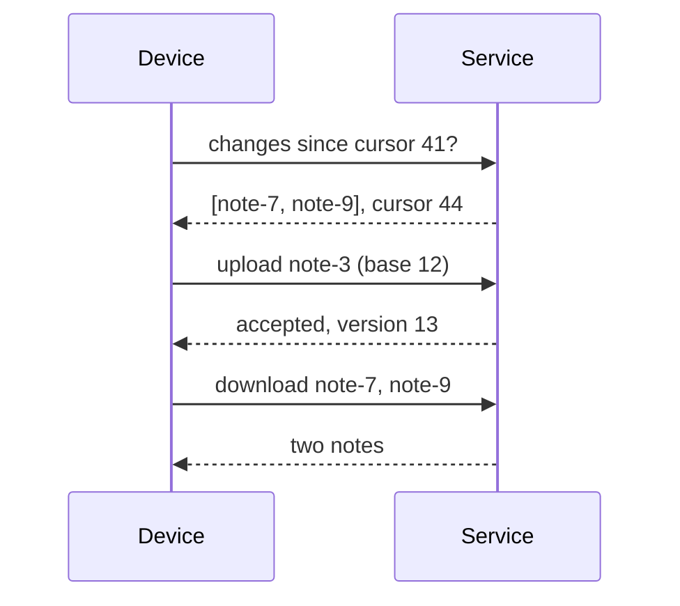

# Sync service: design

Status: draft. This document describes a small service that keeps a folder of
notes in step across devices. It is deliberately boring: files in, files out,
and as little state as will do.

## Goals

- Two devices that edit different notes never conflict.
- Two devices that edit the same note keep both versions until a person picks.
- A device that has been offline for a month catches up without a full scan.
- The server stores nothing it cannot rebuild from the devices.

### Non-goals

- Real-time collaboration on one note. Another tool does that better.
- Access control inside a folder. A folder has one owner.
- Storing history. Devices keep their own backups.

## Overview

A device talks to the service in three steps: it asks what changed since its
last visit, it uploads what it changed, and it downloads what the others
changed. Each step is one request, so a flaky connection loses at most one.

## Data model

| Field | Type | Meaning |
|---|---|---|
| `id` | string | Stable name of the note, never reused |
| `version` | integer | Counts accepted uploads of this note |
| `base` | integer | The version the uploader started from |
| `hash` | string | SHA-256 of the body, to skip identical uploads |
| `deleted` | boolean | Tombstone: the note is gone, the id stays |

A note whose `base` is older than the stored `version` is a conflict. The
service keeps the stored body, files the uploaded one as a sibling named
`<id>.conflict-<n>`, and tells the device what it did.

### Cursor

The cursor is a number that only grows. A device remembers the last one it saw
and sends it with every request; the service answers with the notes whose
version counter passed it. A device that lost its cursor starts from zero and
downloads everything once.

1. The device sends `GET /changes?since=<cursor>`.
2. The service lists note ids with a newer counter, at most 500 at a time.
3. The device asks again with the new cursor until the list is empty.

## Failure modes

What if an upload is half done?

The service writes to a temporary file and renames it, so a note is either the
old body or the new one. The device repeats the upload, and the hash makes the
repeat a no-op if the first one did arrive.

Two cases deserve a closer look:

1. A device uploads, loses the answer, and uploads again. The hash matches the
   stored body, so the second upload is accepted without a new version.
2. A device deletes a note that another device edited. The edit wins and the
   deletion is filed as a conflict, because losing text is worse than keeping a
   note someone wanted gone.

## Open questions

- Should the cursor be per folder or per device?
- How long are tombstones kept?
  - Long enough for the slowest device to see them.
  - Short enough that the list does not grow forever.
- Is 500 notes per page right for a phone on a slow connection?

---

Later sections will cover authentication and rate limits.
