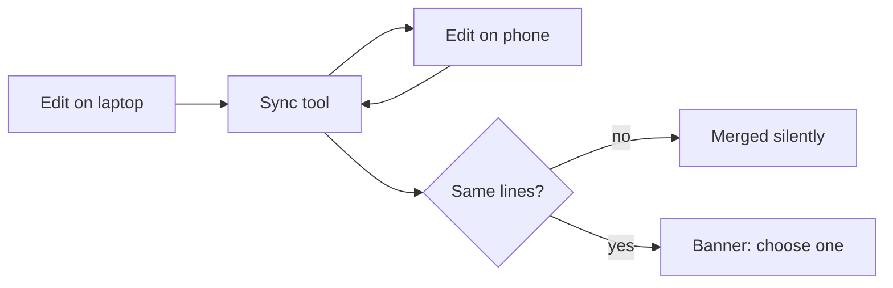

# Notes app guide

<!-- Reference guide for the notes app. Sections are independent: read the one you need. -->

This guide explains how the notes app stores, finds and shows your notes. It
is written for people who like to know where their files are, and for the
scripts that read them.

## The folder

Everything lives in one folder, `~/notes` by default. A note is a markdown file,
and a folder inside it is a notebook. Nothing else is required: no database, no
index file, no hidden state beyond a small cache you can delete at any time.

| Path | What it holds | Safe to delete |
|---|---|---|
| `~/notes/*.md` | Your notes | no |
| `~/notes/.cache/` | The search index and thumbnails | yes |
| `~/notes/.trash/` | Notes you removed, kept for 30 days | yes |
| `~/notes/templates/` | Starting points for new notes | no |

## Writing

A new note starts from a template. The default one is a title and an empty
line to type in. Add your own to `templates/`:

```markdown
# {{title}}

Created {{date}}.

## Next
- [ ] 
```

`{{title}}` and `{{date}}` are filled in when the note is made; any other
braces stay as written.

### Shortcuts

| Keys | Action |
|---|---|
| `Cmd+N` | New note from the default template |
| `Cmd+Shift+N` | New note, pick the template |
| `Cmd+P` | Find a note by name |
| `Cmd+F` | Find inside the open note |
| `Cmd+Enter` | Tick or untick the task under the caret |

1. Press `Cmd+P` and type a few letters of the name.
2. Use the arrow keys to move through the list.
3. Press Enter to open the note, or `Cmd+Enter` to open it in a new window.

## Finding things

Search looks at titles first, then at the text. A query of several words
matches notes that have all of them, in any order. Put a phrase in double quotes
to match it exactly, and use `tag:` to narrow by tag:

```text
budget "march plan" tag:work
```

Results are ranked by how many words match in the title, then by how recently
the note changed. The ranking is deliberately simple, so it is easy to predict.

### Tags

A tag is a word that starts with `#` anywhere in the text. Tags are lower-cased
when they are indexed, so `#Work` and `#work` are the same tag. A `#` inside a
code span or a code block is not a tag.

- `#idea` marks a note you want to come back to.
- `#done` hides a note from the default list.
- Anything else is yours to define.
  - Nested tags use a slash: `#work/reports`.
  - A search for `tag:work` also finds `#work/reports`.

## Syncing

The app does not sync by itself. Put the folder where your sync tool can see
it, and the app will notice changes made elsewhere and reload the open note.
If you change the same lines in two places, the app keeps both versions and
shows a banner so you can choose one.



## Troubleshooting

**The search finds nothing.** Delete `~/notes/.cache/` and reopen the app; the
index is rebuilt in the background and a banner says when it is done.

**A note shows odd characters.** The app reads files as UTF-8. Re-save the file
in that encoding from your old editor and open it again.

**Two notes have the same title.** That is fine: the file name decides which is
which, and the app shows the folder next to the title when it would be unclear.
